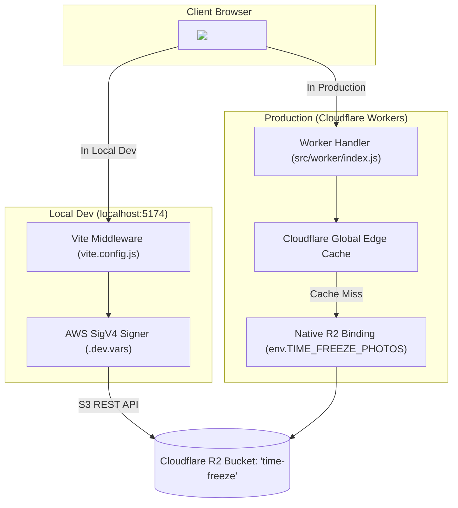

# Time Freeze — System Architecture & Knowledge Base

> **Archival & Engineering Reference**  
> *Last Updated: October 2026*  
> *Author: Pair Programming with Antigravity*

---

## 1. Executive Summary & Storage Philosophy

The **Time Freeze** photography studio platform is designed around a modern **single-source-of-truth** media architecture:
1. **Zero Local Media Files**: All local photography assets in `public/media/` were eliminated to keep the repository lightweight, fast to clone, and free of redundant storage.
2. **Cloudflare R2 as Master Storage**: All photography (WebP, AVIF, original cutouts, and multi-resolution variants) resides exclusively in the private Cloudflare R2 bucket `time-freeze`.
3. **Unified Streaming Origin**: Rather than exposing raw Cloudflare R2 storage URLs or requiring public bucket access, both local development and production use a **unified streaming reverse-proxy pattern** at the `/media/*` path.



---

## 2. Why Image URLs Look Like `/media/...` and Point to "Local" in Dev

### The Question:
> *"Why are images pointing to local URLs (`http://localhost:5174/media/...`) if local images were deleted?"*

### The Answer:
The frontend application uses **relative root paths** (e.g., `src="/media/madurai-solitude-wisdom.webp"` or `/media/hero-timeless-vows?w=1200&fmt=webp`).

When running inside a browser:
- On `http://localhost:5174`, the browser interprets `/media/...` as `http://localhost:5174/media/...`.
- On `https://time-freeze.imselva1512.workers.dev`, the browser interprets `/media/...` as `https://time-freeze.imselva1512.workers.dev/media/...`.

### Why this architecture was chosen:
1. **Private R2 Bucket Security**: The R2 bucket `time-freeze` is kept strictly **private** with no public bucket URL (`pub-xxx.r2.dev`). No public access is enabled or needed.
2. **Zero CORS Issues**: Because images are requested from the exact same origin (host and port) as the web application, there are no cross-origin errors, CORS preflights, or CDN header configuration issues.
3. **Edge Caching**: Cloudflare Workers caches the R2 response at edge data centers using `Cache-Control: public, max-age=31536000, immutable`.
4. **Zero Code Differences**: The React components (`HeroSection`, `ChaptersSection`, `FrozenMomentsSection`, etc.) do not need environment switches (`if dev then X else Y`). The same relative path works everywhere.

---

## 3. Local Development Streaming Flow (`vite.config.js`)

In local development, Vite intercepts all requests starting with `/media/`:

```javascript
// vite.config.js
server.middlewares.use(async (req, res, next) => {
  if (url.pathname.startsWith('/media/')) {
    // 1. Parse clean slug and query params (w, fmt)
    // 2. Resolve candidate keys in R2
    // 3. Authenticate with AWS SigV4 using .dev.vars credentials
    // 4. Stream R2 response buffer directly with Content-Type & Cache headers
  }
});
```

### AWS SigV4 Signer:
- R2 provides an S3-compatible endpoint: `https://<CLOUDFLARE_ACCOUNT_ID>.r2.cloudflarestorage.com/<R2_BUCKET_NAME>/<KEY>`.
- Vite signs each request on-the-fly using SHA256 and HMAC-SHA256 based on `R2_ACCESS_KEY_ID` and `R2_SECRET_ACCESS_KEY` loaded from `.dev.vars`.
- The user does not need an S3 SDK installed.

### Candidate Key Resolution:
To handle slugs with extensions (e.g., `madurai-solitude-wisdom.webp`), raw IDs, and category directories with triple hyphens (`candid---moments`), Vite iterates through candidate keys:
1. `basePath/${width}.${fmt}` (e.g. `time-freeze/candid---moments/madurai-solitude-wisdom/1170.webp`)
2. `item.key` directly from `src/data/manifest.json`
3. `item.thumbnailKey`
4. Standard width variants: `1200.webp`, `1170.webp`, `800.webp`, `480.webp`
5. Direct fallback paths: `time-freeze/${category}/${slug}/${width}.webp` and `time-freeze/uploads/...`

---

## 4. Production Cloudflare Worker Flow (`src/worker/index.js`)

In production, Cloudflare Workers serves the pre-rendered static assets and handles media routing:

```javascript
// src/worker/index.js
export default {
  async fetch(request, env, ctx) {
    const url = new URL(request.url);

    if (url.pathname.startsWith('/media/')) {
      return await handleMedia(request, env, url);
    }

    // Static asset fallback
    return await env.ASSETS.fetch(request);
  }
}
```

### Key Highlights:
- **Binding**: Uses `env.TIME_FREEZE_PHOTOS` (native Cloudflare R2 binding, avoiding HTTP latency).
- **KV Fallback**: If KV namespace `TIME_FREEZE_META` has not been seeded, the Worker automatically falls back to the embedded `manifestPhotos` array from `src/data/manifest.json` and `DEFAULT_SITE_CONTENT` from `src/data/defaultSiteContent.js`.
- **Candidate Key Search**: Same multi-key fallback as Vite to guarantee that cover images, thumbnails, and responsive widths load reliably.

---

## 5. Mobile Responsiveness & Viewport Overhaul

### Problems Identified:
1. **Document Blowout & Zoom-out**: The mobile screen auto-zoomed out, displaying a 50% squeeze of content on the left with a massive dark empty void on the right.
2. **Jittery Smooth Scrolling**: Lenis smooth scrolling fought against native touch momentum on iOS and Android devices.
3. **Card Blurs on Mobile**: Touch screens kept gallery cards blurred due to missing hover states.

### Solutions Implemented:

| Problem | Root Cause | Implemented Solution |
| :--- | :--- | :--- |
| **Horizontal Void** | `.hero-leaf-right` had `right: -40px`; ambient glow orbs were fixed `w-[700px]`, `w-[600px]`. | Clamped body with `overflow-x: clip; max-width: 100vw;`. Clamped leaves to `0px` margin. Restricted ambient glow orbs to `w-[min(500px, 90vw)]` with `overflow-hidden`. |
| **Touch Scroll Lag** | Lenis running on touch screens. | Disabled Lenis when `(pointer: coarse)` or viewport `< 768px` in `src/App.jsx`. Restored 120Hz native touch scrolling. |
| **Frozen Moments** | GSAP pinned horizontal scrollbar was too heavy for mobile screens. | Converted mobile layout into a native touch snap carousel (`overflow-x-auto snap-x snap-mandatory`) with unblurred cards. |
| **Hero Cutout** | Cutout image was fixed 600px tall. | Responsive height clamp: `h-[320px]` on mobile, `h-[460px]` on tablet, `h-[600px]` on desktop. |
| **Chapters Accordion** | Fixed 560px accordion height caused card text truncation. | Switched to responsive flex column on mobile with `min-h-[300px]` and natural stacking. |
| **Custom Cursor** | Lagged on touch screens. | Hidden completely on touch devices via CSS `hidden md:block`. |

---

## 6. Configuration & Deployment Reference

### Environment Variables (`.dev.vars`)
```ini
ADMIN_PASSWORD=<ADMIN_PASSWORD>
JWT_SECRET=<JWT_SECRET>
WHATSAPP_NUMBER=+919025299312
CLOUDFLARE_ACCOUNT_ID=<CLOUDFLARE_ACCOUNT_ID>
CLOUDFLARE_API_TOKEN=<CLOUDFLARE_API_TOKEN>
R2_BUCKET_NAME=time-freeze
R2_ACCESS_KEY_ID=<R2_ACCESS_KEY_ID>
R2_SECRET_ACCESS_KEY=<R2_SECRET_ACCESS_KEY>
KV_NAMESPACE_ID=cf7b6ce6316d4d9c9fefd5ffa9d5ffbe
ALLOWED_ORIGIN=*
```

### Wrangler Configuration (`wrangler.toml`)
```toml
name = "time-freeze"
main = "src/worker/index.js"
compatibility_date = "2026-09-01"

[assets]
directory = "./dist"
binding = "ASSETS"
run_worker_first = true

[vars]
WHATSAPP_NUMBER = "+919025299312"
ALLOWED_ORIGIN = "*"
R2_BUCKET_NAME = "time-freeze"

[[kv_namespaces]]
binding = "TIME_FREEZE_META"
id = "cf7b6ce6316d4d9c9fefd5ffa9d5ffbe"

[[r2_buckets]]
binding = "TIME_FREEZE_PHOTOS"
bucket_name = "time-freeze"
```

### Essential Terminal Commands

- **Run Dev Server Locally**:
  ```bash
  npm run dev
  ```
- **Build Frontend**:
  ```bash
  npm run build
  ```
- **Deploy to Cloudflare Workers**:
  ```bash
  npx wrangler deploy
  ```
- **Verify Live Media Stream**:
  ```bash
  curl -I https://time-freeze.imselva1512.workers.dev/media/madurai-solitude-wisdom.webp
  ```

---

## 7. Troubleshooting Cheatsheet

| Symptom | Cause | Solution |
| :--- | :--- | :--- |
| **Image broken in local dev (`http://localhost:5174/`)** | Browser cached a previous 404, or Vite dev server had not restarted after editing `vite.config.js`. | 1. Hard refresh with `Ctrl + F5` (or `Cmd + Shift + R`).<br>2. Check that `.dev.vars` has correct R2 credentials.<br>3. Restart the dev server (`npm run dev`). |
| **Image broken on production (`time-freeze.workers.dev`)** | Missing R2 key mapping or unseeded KV. | 1. Verify that `manifestPhotos` in `src/data/manifest.json` contains the item slug.<br>2. Run `npx wrangler deploy` to update the worker logic. |
| **Mobile screen has horizontal whitespace** | An element with fixed width or negative margin exceeds `100vw`. | Add `overflow-hidden` or clamp widths with `w-[min(Xpx, 90vw)]`. Ensure `overflow-x: clip;` remains on `html, body, #root`. |
